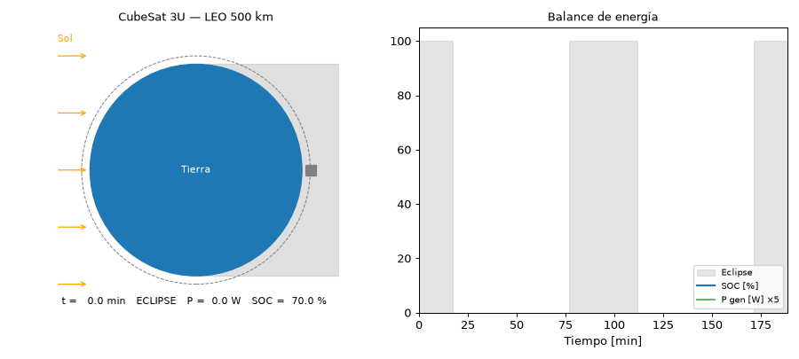

# When Night Is Not the Problem 🛰️
### Energy budget simulation of a 3U CubeSat as a LoRa backhaul for emergency mesh networks

Modular Python simulation of the energy balance of a nadir-pointing
3U CubeSat in low Earth orbit (LEO, 500 km), operating as a
store-and-forward LoRa backhaul for terrestrial emergency
communication mesh networks.

This repository accompanies the paper *"When Night Is Not the
Problem: Energy Analysis of a 3U CubeSat Relaying Emergency LoRa
Traffic"* (Universidad Andrés Bello, 2026) and ensures the
reproducibility of all its results and figures.

## Demo



The satellite (gold in sunlight, gray in eclipse) keeps nadir
pointing while orbiting at 500 km. The right panel shows the
generated power and the battery state of charge in real time.

## Project structure

```
cubesat-eps-sim/
├── src/
│   ├── orbita.py             # orbital geometry and eclipse detection
│   ├── irradiancia.py        # solar vector and incidence angle per face
│   ├── potencia.py           # photovoltaic model and generated power
│   ├── bateria.py            # consumption profile and energy balance (baseline case)
│   ├── lora.py               # LoRa module: passes and traffic scenarios
│   ├── escenarios_lora.py    # case study: SOC under LoRa traffic
│   ├── panel.py              # cell I-V/P-V curve with MPP
│   ├── beta_sweep.py         # beta-angle sweep of the energy margin (Discussion)
│   ├── fig_cubesat_faces.py  # body frame and face nomenclature figure
│   ├── main.py               # orchestrator: final IEEE-style figures
│   └── animacion.py          # orbit GIF with live energy balance
├── figures/                  # exploratory figures and GIF
│   └── final/                # publication figures (generated by main.py)
├── requirements.txt
└── README.md
```

## Reproduce

```bash
pip install -r requirements.txt
python src/main.py          # regenerates all paper figures
python src/beta_sweep.py    # beta-angle sweep reported in the Discussion
python src/animacion.py     # regenerates the GIF (1-2 min)
```

Each module can also be run individually (`python src/orbita.py`,
etc.) to see its exploratory figures and numerical validations.

## Main parameters

| Parameter | Value | Source |
|---|---|---|
| Orbit | Circular, 500 km, β = 0 | N/A |
| Period / eclipse | 94.47 min / 35.71 min (37.8%) | Kepler + cylindrical shadow |
| Satellite | 3U (10×10×34 cm), nadir pointing, body-mounted panels | N/A |
| Solar constant | 1361 W/m² | Kopp & Lean (2011) |
| Solar cell | Triple junction, η = 29.5% @ AM0, 28 °C | AzurSpace 3G30C-Advanced |
| Battery | Li-ion 2S2P, 7.4 V, 38.5 Wh, max DoD 30% | GomSpace BP4 |
| Bus consumption | 1.75 W (survival) / 3.75 W (with payload) | GomSpace datasheets |
| LoRa | SX1276: RX 0.035 W, TX 1.5 W (with PA), SF12, airtime 2.3 s | Semtech datasheet |
| Passes | 4/day × 10 min (2 daytime + 2 nighttime), scheduled | N/A |

## Main findings

**F1. The nadir face is nearly useless for power generation.**
Its maximum irradiance reaches only ≈510 W/m² (37.5% of the nominal
value). Its optimal illumination instant falls inside Earth's
shadow, so it only sees the Sun at the eclipse boundaries.
Analytically validated with sin θ = R⊕/r, which gives
cos θ = √(1 − (R⊕/r)²) ≈ 0.375. This is consistent with the practice
of reserving the nadir face for payload and antennas.

**F2. The daytime generation minimum occurs at the subsolar point.**
The total power curve has an "M" shape. At the instant of maximum
illumination only the zenith face generates (10×10 cm, ~3.2 W),
because the ram and wake faces cross zero. The nadir-pointing 3U
geometry penalizes orbital noon, which motivates deployable panels.

**F3. The baseline energy balance closes with a ~1.7× margin.**
The orbit-average generation of 5.21 W compares with an
orbit-average consumption of ~3.0 W. Eclipse discharges are about
3 SOC points, well below the 30% DoD limit.

**F4. The bottleneck of the LoRa backhaul is the channel, not
energy.** With SF12 (airtime 2.3 s/packet), a 10-min pass has a
physical capacity of 260 packets, regardless of the available
energy. Duty cycles are 19.2% (normal, 50 packets), 57.5%
(emergency, 150 packets), and 100% saturated (disaster, 400+
packets). Energy per pass is 52.6 / 146.2 / 250.0 mWh, which stays
below 1% of the battery even when saturated.

**F5. The night pass is the energetic worst case, and it still has
ample margin.** Transmitting during eclipse (nighttime emergency)
draws purely from the battery with zero generation, yet the impact
stays below 1% of SOC per pass. The SOC curves of the three traffic
scenarios are indistinguishable.

**F6. The operational constraint of the mission is channel
capacity, not the energy budget.** As a corollary of F4 and F5, a
standard 3U EPS supports the LoRa backhaul with ample margin even in
a disaster. The resulting design space includes more passes per day,
a smaller battery, additional payload, adaptive SF, and DTN
store-and-forward architectures to absorb excess traffic between
passes.

**F7. β = 0 is the worst case, so the reported margin is a lower
bound.** A beta-angle sweep with the same model (`beta_sweep.py`)
shows that the margin grows from 1.7× at β = 0 to about 3× for
β ≥ 60°, while eclipse discharges fall below 2% of SOC.

## Assumptions and limitations

- 2D case with β = 0. This is the worst case for both eclipse
  duration and lateral-face generation (the ±Y faces do not
  generate), so the reported margin is conservative.
- Cylindrical shadow (penumbra neglected, since it lasts only a few
  seconds at 500 km).
- Scheduled passes (the 2D simulation does not model Earth's
  rotation).
- Energy-based balance (Wh). The 7.4 V bus voltage is kept for
  documentation only and does not enter the calculation.
- Ideal MPPT (extraction always at the MPP), justified with the
  cell I-V curve.
- No thermal or radiation-degradation model, so absolute generation
  values are optimistic toward end of life.
- LoRa link budget closure at 500 km is outside the scope. Flight
  data from the NORBY CubeSat indicate that the SF12 Doppler effect
  shortens the effective pass, so 260 packets is an upper bound.
- The simulation starts at eclipse exit to avoid initial-condition
  artifacts.

## Cross-validations

Each module was validated against analytical values before
integration:

- Orbital period: 94.47 min (Kepler, error < 0.1%).
- Eclipse fraction: 37.8% vs. analytical arcsin(R⊕/r)/π = 37.8%.
- Maximum nadir-face irradiance: ≈510 W/m² vs. analytical
  1361 · √(1 − (R⊕/r)²) = 509.7 W/m².
- Cell MPP: 1.21 W @ 2.41 V, which reproduces the datasheet
  catalog points (Vmp = 2411 mV, Imp = 504.4 mA).
- Efficiency at the MPP: 29.5%, consistent with the η = 0.29 used
  in the power model (mutual consistency of the electrical and
  energy models).

## Context

This work was developed as the final project of the course Energy
Transformation and Control (*Transformación y Control de la Energía
Eléctrica*) and is connected to the doctoral research on a resilient
emergency communications architecture (terrestrial LoRa mesh + DTN +
satellite backhaul) at Universidad Andrés Bello, Chile.

## Author

Marcela Quezada-Araya, Universidad Andrés Bello, Santiago, Chile.

If you use this code, please cite the repository or the associated
paper.
